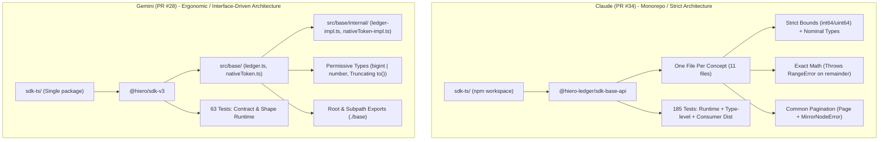
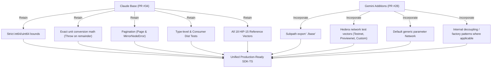

# Comparative Analysis: Claude (PR #34) vs. Gemini (PR #28 / Current Code)
## Hiero SDK v3 TypeScript Implementation

**Date:** November 6, 2026  
**Authors:** Architecture & Engineering Review  
**Subject:** Technical evaluation and synthesis of PR #34 (`claude`) and the current branch / PR #28 (`gemini`)

---

## 1. Executive Summary & Eagle Eye View

Both **Claude** (PR #34, branch `claude-ts-implementation` at commit `fc3737a3`) and **Gemini** (current branch `add-network-identity-public-api-ts-impl` / PR #28 at commit `3b4d7fe8`) provide TypeScript implementations for the foundational Hiero SDK v3 base specifications.

While both implementations share key underlying primitives—such as `bigint` for arbitrary-precision numeric values, ECMAScript private fields (`#`), and the canonical HIP-15 address checksum algorithm—they reflect fundamentally different engineering philosophies:

- **Claude (`PR #34`)** follows a **strict, defensive, and mathematically sound domain model**. It treats value types as nominal entities, prevents precision loss by rejecting inexact conversions, enforces strict 64-bit integer boundaries (`int64`/`uint64`), provides compile-time finality, includes end-to-end consumer compilation tests against built definitions, and implements all four base specifications—including asynchronous pagination (`Page<T>`) and `MirrorNodeError`.
- **Gemini (`Current / PR #28`)** follows an **ergonomic, interface-driven, and permissive model**. It decouples public API abstractions from unexported internal classes (`createNetwork()` factory + `NetworkImpl`), provides convenient subpath exports (`@hiero/sdk-v3/base`), supports realistic multi-network test fixtures (Mainnet, Testnet, Previewnet, and Custom Ledgers), and accepts both `number` and `bigint` inputs. However, it permits silent integer truncation in conversions, does not enforce 64-bit upper bounds, permits non-canonical address strings, and has not yet implemented the common pagination specification.



### High-Level Eagle Eye Comparison

| Dimension | Claude (PR #34) | Gemini (Current / PR #28) | Architectural Impact & Assessment |
| :--- | :--- | :--- | :--- |
| **Recommendation** | **Adopt as Core Base** | **Port Fixtures & Subpaths** | Claude provides a strictly verified, mathematically rigorous foundation. |
| **Changes Implemented** | **4 Changes** (Native Token, Network Identity, Numeric Address, Common Pagination) | **3 Changes** (Native Token, Network Identity, Numeric Address) | Claude is feature-complete with respect to current base deltas. |
| **Workspace Architecture** | Monorepo / npm workspace (`@hiero-ledger/sdk-base-api`) | Single flat package (`@hiero/sdk-v3`) | Claude prepares the repository for multi-package expansion (e.g., crypto, consensus). |
| **Source Organization** | 11 granular files (`one-type-per-file`) | 6 composite files organized by domain namespace (`src/base/`) | Claude is easier to navigate per symbol; Gemini keeps namespace cohesion. |
| **Public API Surface** | Concrete/abstract classes (`Network`, `Address`, `Page`) | Interfaces + Factory functions (`createNetwork()`, `NetworkImpl`) | Gemini achieves cleaner encapsulation of internal state; Claude simplifies instantiation. |
| **Typing Strategy** | Nominal classes (`instanceof` verification) | Structural interfaces (`NativeTokenUnit` interface) | Claude prevents structural spoofing of token units and networks. |
| **Numeric Strictness** | Strict `bigint` only, verified against `int64`/`uint64` ranges | Flexible `bigint \| number`, no upper 64-bit bound checks | Claude eliminates JavaScript float rounding and overflow bugs. |
| **Conversion Math** | **Exact only**; throws `RangeError` on remainder | **Truncating**; performs floor division `/` silently | **Critical**: Gemini silently loses precision; Claude protects financial integrity. |
| **Address Validation** | `validateChecksum()` returns `false` if no checksum | `validateChecksum()` returns `true` if no checksum | Semantic difference: Claude checks checksum validity; Gemini checks entity admissibility. |
| **Address Extensibility** | Final (private constructor + `Address.of()`) | Extensible (public constructor + `Object.freeze()`) | Claude prevents invalid subclassing; Gemini allows extension. |
| **Verification Scope** | 185 tests (Runtime, Type tests `*.test-d.ts`, Consumer compile) | 63 tests (Runtime contracts, inline `expectTypeOf`) | Claude guarantees external consumer compatibility against built declarations. |
| **HIP-15 Coverage** | All 18 official HIP-15 reference vectors | 1 official vector + 4 real Hedera network vectors | Both have unique value: Claude proves spec compliance; Gemini proves real-world compatibility. |

---

## 2. Granular Architectural & Implementation Comparison

### 2.1 Workspace Structure & Module Packaging

```
Claude (PR #34):
sdk-ts/
├── package.json                   (workspaces: ["hiero-sdk-base-api"])
├── tsconfig.base.json
└── hiero-sdk-base-api/
    ├── package.json               (@hiero-ledger/sdk-base-api)
    ├── tsconfig.json / tsconfig.build.json
    ├── src/
    │   ├── int64.ts               (Integer boundary enforcement)
    │   ├── native-token-unit.ts   (Abstract class)
    │   ├── native-token.ts        (Abstract class)
    │   ├── network.ts             (Concrete class)
    │   ├── base-address.ts        (Abstract class)
    │   ├── address.ts             (Final class via private constructor)
    │   ├── checksum.ts            (HIP-15 implementation)
    │   ├── illegal-format-error.ts
    │   ├── page.ts                (Pagination abstraction)
    │   ├── mirror-node-error.ts
    │   └── index.ts
    └── test/                      (Unit, type-level, and consumer tests)

Gemini (Current / PR #28):
sdk-ts/
├── package.json                   (@hiero/sdk-v3)
├── tsconfig.json
├── vitest.config.ts
├── src/
│   ├── index.ts                   (Re-exports base)
│   └── base/
│       ├── index.ts               (Namespace export)
│       ├── nativeToken.ts         (NativeTokenUnit interface + NativeToken class)
│       ├── ledger.ts              (Network interface, BaseAddress, Address)
│       └── internal/
│           ├── ledger-impl.ts     (NetworkImpl + calculateHip15Checksum)
│           └── nativeToken-impl.ts (GenericNativeToken)
└── tests/
    └── contract/                  (Runtime contract tests)
```

#### Key Differences:
1. **Package Scope:** Claude adopts npm workspaces under the scoped organization `@hiero-ledger/sdk-base-api`. This follows the multi-package architecture intended for modern modular SDKs (e.g. separating base primitives from consensus and mirror node clients). Gemini uses a single monolithic package `@hiero/sdk-v3`.
2. **Subpath Exports:** Gemini configures `./base` as a subpath export in `package.json`, allowing consumer code to import directly from `@hiero/sdk-v3/base`. Claude currently exports only `.`.
3. **Internal Decoupling:** Gemini explicitly segregates private implementations under `src/base/internal/` and prevents them from being exported in public entry points. Claude houses logic in public class getters and private `#` members within the same file.

---

### 2.2 Native Token & Conversion Mathematics

The handling of token amounts and units highlights the divergence between strict financial safety and permissive developer ergonomics:

```typescript
// Claude (PR #34) - Exact conversion or throw
to(targetUnit: Unit): Self {
  const baseUnits = this.toBaseUnits();
  const factor = targetUnit.baseUnitFactor;
  if (baseUnits % factor !== 0n) {
    throw new RangeError(
      `${this.#amount.toString()} ${this.#unit.symbol} cannot be expressed exactly in ${targetUnit.symbol}`,
    );
  }
  return this.create(baseUnits / factor, targetUnit);
}
```

```typescript
// Gemini (PR #28) - Silent floor truncation
to(targetUnit: Unit): Self {
  // ... null and range validation ...
  const targetFactor = BigInt(targetUnit.baseUnitFactor);
  const baseUnits = this.toBaseUnits();
  const convertedAmount = baseUnits / targetFactor; // BigInt division truncates towards zero!
  return this.create(convertedAmount, targetUnit);
}
```

#### Behavioral Impact:
- **Precision Loss:** Suppose an account holds `250 tinybars` and a caller converts to `microbar` (factor `100`).
  - **Claude:** Throws `RangeError: 250 tℏ cannot be expressed exactly in μℏ`. The caller is forced to handle the indivisible remainder explicitly.
  - **Gemini:** Returns `2 microbars`. The remaining `50 tinybars` are silently discarded. In financial transactions, silent truncation can lead to balance reconciliation discrepancies and lost funds.
- **Unit Representation:**
  - **Claude:** `NativeTokenUnit` is an `abstract class`. It validates that `baseUnitFactor` is a positive `int64` and checks `unit instanceof NativeTokenUnit`. Units are **nominal**.
  - **Gemini:** `NativeTokenUnit` is an `interface` accepting `bigint | number`. Any object literal matching `{ symbol: "ℏ", baseUnitFactor: 100000000 }` satisfies the type structurally.

---

### 2.3 Integer Bounds & Type Strictness (`int64` / `uint64`)

The language-neutral Hiero specification defines amounts, factors, and address numbers as fixed-width integers (`int64`, `uint64`).

```typescript
// Claude: Dedicated int64.ts utilities
const INT64_MIN = -(2n ** 63n);
const INT64_MAX = 2n ** 63n - 1n;
const UINT64_MAX = 2n ** 64n - 1n;

export function requireInt64(value: bigint, name: string): bigint { ... }
export function requireUint64(value: bigint, name: string): bigint { ... }
```

- **Claude:**
  - Token amounts and unit factors are strictly validated with `requireInt64` (`-2^63` to `2^63 - 1`).
  - Shard, realm, and entity numbers are strictly validated with `requireUint64` (`0` to `2^64 - 1`).
  - Any input exceeding these boundaries throws a `RangeError`. Passing a `number` throws a `TypeError`.
- **Gemini:**
  - Accepts `number` or `bigint`. For `number`, checks `Number.isSafeInteger()`.
  - For `bigint`, **does not enforce upper bounds**. A shard or entity number of `2n ** 128n` is accepted without error.
  - While JavaScript numbers provide convenience, accepting IEEE-754 floating point numbers introduces silent precision hazards for 64-bit ledger values above $2^{53} - 1$.

---

### 2.4 Addressing, Checksums & HIP-15 Conformance

#### 1. Address Construction & Finality:
- **Claude:** Enforces API guideline `@@finalType` by marking the constructor `private` and exposing the static factory `Address.of(shard, realm, num, checksum)`. This makes `Address` impossible to extend, preventing invalid subclassing.
- **Gemini:** Exposes a public constructor `new Address(shard, realm, num, checksum)`. Immutability is sealed via runtime `Object.freeze(this)`.

#### 2. Address Parsing Grammar:
- **Claude:** Uses canonical HIP-15 regex `/^(0|[1-9]\d*)\.(0|[1-9]\d*)\.(0|[1-9]\d*)(?:-([a-z]{5}))?$/`. Leading zeroes (e.g. `00.00.0123`) are **rejected** as invalid formats.
- **Gemini:** Uses relaxed regex `/^(\d+)\.(\d+)\.(\d+)(?:-([a-z]{5}))?$/`. Leading zeroes are parsed and cast via `BigInt()`.

#### 3. Checksum Validation Semantics:
```typescript
// Claude: Strict checksum match
override validateChecksum(network: Network<NativeTokenUnit>): boolean {
  if (!(network instanceof Network)) {
    throw new TypeError("network must be a Network");
  }
  return this.checksum !== "" && this.checksum === hip15Checksum(network.id, this.toString());
}
```
```typescript
// Gemini: Permissive address admissibility
validateChecksum(network: Network<any>): boolean {
  if (network === undefined || network === null) {
    throw new TypeError('Network must not be null or undefined');
  }
  if (this.#checksum === '' || this.#num === null) {
    return true; // Treats address without checksum as valid
  }
  const expected = calculateHip15Checksum(this.toString(), network.id);
  return this.#checksum === expected;
}
```

- **Semantic Divergence:**
  - In **Claude**, `validateChecksum()` answers: *"Does this address carry a valid checksum for this network?"* If the address has no checksum, it returns `false`.
  - In **Gemini**, `validateChecksum()` answers: *"Is this address permissible on this network?"* Under HIP-15, addresses without checksums are acceptable on any network, so it returns `true`.
  - **Verdict:** Both interpretations represent valid engineering trade-offs. However, the method name `validateChecksum` implies validating the checksum itself; returning `true` when no checksum exists can lead callers to believe an unverified address was cryptographically checked against the network.

---

### 2.5 Common Pagination & Mirror Node Error

Gemini has not yet implemented the `add-common-pagination-public-api` specification in `sdk-ts`. Claude provides a complete implementation:

- **`Page<T>` Abstract Base Class:**
  - Immutable `#data: ReadonlyArray<T>` snapshot, defensively copied and frozen (`Object.freeze([...data])`).
  - `#size` and `#pageIndex` validated as signed 32-bit integers (`int32`).
  - Abstract navigation methods: `hasNext(): boolean`, `isFirst(): boolean`, `next(): Promise<Page<T>>`, `first(): Promise<Page<T>>`.
- **`MirrorNodeError` Class:**
  - Extends native `Error`.
  - Supports standard `ErrorOptions` with `cause` forwarding for network/HTTP diagnostics.

---

### 2.6 Testing Strategy & Verification Rigor

| Verification Pillar | Claude (PR #34) | Gemini (Current / PR #28) |
| :--- | :--- | :--- |
| **Total Test Cases** | **185 tests** across 15 files | **63 tests** across 6 files |
| **Type-Level Tests** | Dedicated `*.test-d.ts` files testing type assignability, variance, and `@ts-expect-error` | Inline `expectTypeOf()` assertions within runtime tests |
| **Consumer Compilation** | **Yes:** Compiles 4 consumer files against built `dist/` types via `tsc -p test/consumer/tsconfig.json --noEmit` | **No:** Tests import directly from local `src/` modules |
| **Package Boundary Verification** | Asserts exact exported symbol list, zero runtime dependencies, and correct package manifest | Relies on basic export statements |
| **HIP-15 Test Vectors** | All 18 official vectors for both single-byte (`0x00`) and multi-byte (`0xa1ff01`) ledgers | 1 official vector + 4 real Hedera ecosystem fixtures (Mainnet, Testnet, Previewnet, Custom) |
| **Negative Testing** | Extensive: invalid types, out-of-range integers, malformed strings, inexact divisions | Focuses primarily on format regex and null checks |

---

## 3. Detailed Side-by-Side Code Matrix

| Feature / Behavior | Claude (PR #34) | Gemini (Current / PR #28) | Alignment / Recommendation |
| :--- | :--- | :--- | :--- |
| **`NativeTokenUnit`** | `abstract class NativeTokenUnit`<br>• Enforces positive `int64` factor<br>• Nominal type check via `instanceof` | `interface NativeTokenUnit`<br>• `baseUnitFactor: bigint \| number`<br>• Structural typing | **Adopt Claude:** Nominal class prevents accidental cross-token unit mixing. |
| **`NativeToken.amount`** | Strictly `bigint`<br>• Enforces `-2^63 <= amount <= 2^63 - 1` | `bigint \| number`<br>• Allows `number` if safe integer<br>• No upper bound on `bigint` | **Adopt Claude:** Disallowing `number` avoids float rounding pitfalls. |
| **`NativeToken.to()`** | Exact division only; throws `RangeError` if `baseUnits % factor !== 0n` | Floor division `/`; silently truncates fractional remainders | **Adopt Claude:** Essential for financial safety. Truncation should require an explicit method (e.g. `toTruncated()`). |
| **`Network`** | Exported concrete class `Network<Unit extends NativeTokenUnit>` | Exported interface `Network<Unit>` + `createNetwork()` factory + unexported `NetworkImpl` | **Hybrid:** Adopt Claude's nominal validation with Gemini's interface/factory encapsulation pattern. |
| **`Network.id`** | Defensively copied on construction and getter (`slice()`) | Defensively copied on construction and getter (`new Uint8Array(...)`), frozen | Both are secure; Gemini adds `Object.freeze(this)`. |
| **`Network` Unit Wildcard** | `Network<NativeTokenUnit>` required | `Network<Unit = NativeTokenUnit>` defaults generic parameter | **Adopt Gemini:** Default type argument allows writing `Network` without boilerplate. |
| **`Address` Constructor** | `private constructor`<br>Factory: `Address.of(shard, realm, num, checksum)` | `public constructor`<br>`new Address(shard, realm, num, checksum)` | **Adopt Claude:** Implements `@@finalType` to prevent invalid subclassing. |
| **`Address.fromString()`** | Rejects leading zeroes and non-canonical integers | Accepts leading zeroes (`00.00.0123` parses to `0.0.123`) | **Adopt Claude:** Strict adherence to HIP-15 grammar prevents ambiguous identifiers. |
| **`validateChecksum()` with empty checksum** | Returns `false` | Returns `true` | **Specification Decision Required:** Clarify at common spec level whether empty checksums validate as true or false. |
| **Real Hedera Vectors** | Only tests synthetic HIP-15 vectors | Tests Mainnet (`0x00`), Testnet (`0x01`), Previewnet (`0x02`), and Custom (`0x0c1f0002`) | **Adopt Gemini Fixtures:** Excellent integration vectors that should be merged into Claude's test suite. |
| **Subpath Exports** | Exports `.` only | Exports `.` and `./base` | **Adopt Gemini:** Subpath exports simplify modular consumer imports. |
| **Common Pagination** | Fully implemented (`Page<T>`, `MirrorNodeError`) | Not implemented | **Adopt Claude:** Complete implementation of common delta change 1. |

---

## 4. Strengths & Trade-offs Summary

### Claude (PR #34) Strengths:
1. **Mathematical & Financial Integrity:** Disallows silent truncation during unit conversions and strictly bounds integers to 64 bits.
2. **Comprehensive Verification:** 185 tests including type-level tests (`*.test-d.ts`), consumer compilation tests against package `dist/`, and complete HIP-15 reference vectors.
3. **Specification Completeness:** Implements all 4 common specifications, including Pagination and MirrorNodeError.
4. **Architectural Preparation:** Workspace-ready monorepo layout prepared for multi-package expansion.

### Gemini (Current / PR #28) Strengths:
1. **API Encapsulation:** Clean separation between public interfaces and internal concrete implementations (`src/base/internal/`).
2. **Realistic Network Fixtures:** Tests real Hedera network IDs (Mainnet `0x00`, Testnet `0x01`, Previewnet `0x02`, Custom `0x0c1f0002`) and zero addresses (`0.0.0-uvnqa`).
3. **Ergonomic Subpath Exports:** Exposes `./base` for convenient, uncluttered imports.
4. **Defensive Freezing:** Actively freezes instances (`Object.freeze(this)`) to guard against prototype/runtime tampering in non-TypeScript environments.

---

## 5. Synthesis & Unification Roadmap

To deliver the highest-quality, enterprise-grade TypeScript SDK, we recommend combining the strengths of both branches:



### Action Items for Merge:
1. **Adopt Claude's Codebase as the Foundational Baseline:**
   - Retain the workspace layout (`hiero-sdk-base-api`).
   - Retain the strict `int64.ts` bounds validation and exact conversion math in `native-token.ts`.
   - Retain `page.ts` and `mirror-node-error.ts`.
   - Retain the full testing matrix (185 tests, `test-d.ts`, consumer compilation).
2. **Port Valuable Enhancements from Gemini:**
   - Add the `./base` subpath export to `package.json`.
   - Add default generic argument `Network<Unit extends NativeTokenUnit = NativeTokenUnit>`.
   - Port Gemini's real-world network test vectors (Testnet `0x01`, Previewnet `0x02`, Custom Ledger `0x0c1f0002`, and Mainnet zero address `0.0.0-uvnqa`) into `address.test.ts`.
3. **Align Common Specification on Empty Checksums:**
   - Submit an RFC / discussion to the common specification working group to formally define whether `BaseAddress.validateChecksum()` on an address without a checksum returns `true` (admissible) or `false` (no checksum to validate).
