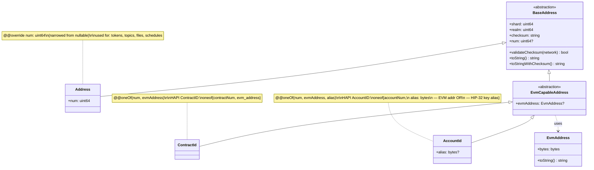

# Ledger API

## Description

Foundational types that identify a Hiero network and the entities that live on it. They are used
throughout the SDK wherever a network, a node, an account, a contract or another ledger entity is
referenced.

`Network` identifies a specific network instance and the unit of its native token. `ConsensusNode`
and `MirrorNode` describe the nodes of a network that a client talks to; `IpAddress` holds the
address of a consensus node.

Every entity on a Hiero ledger lives in a `(shard, realm)` space and is selected within that space by
a third part — usually a number. `BaseAddress` is the common base of all entity identifiers and
provides the shard, the realm, the checksum and the string forms. The concrete identifier types are:

- `Address` — entities that are always identified by `shard.realm.num`: tokens, topics, files and
  schedules. `num` is always set.
- `ContractId` — a smart contract, identified either by its number or by its 20-byte EVM address
  (exactly one of the two is set).
- `AccountId` — an account, identified by its number, by an EVM-address alias, or by a public-key
  alias (exactly one of the three is set).
- `EvmAddress` — a raw 20-byte EVM address, used inside `ContractId` / `AccountId` and wherever an
  EVM address appears on its own.

All identifier types can be parsed from and formatted to their canonical string form
(e.g. `0.0.1234` or `0.0.1234-abcde` with checksum). `TransactionId` identifies a transaction by its
payer account and valid-start time. The constants `ZERO_ADDRESS`, `ZERO_ACCOUNT_ID` and
`ZERO_CONTRACT_ID` are used in update transactions to remove a previously configured value.

## Design Notes

### The address hierarchy

Every entity on a Hiero ledger lives in a `(shard, realm)` space; what differs between entity
kinds is only the **selector** — the third part of the identifier that picks the specific
entity within `(shard, realm)`. That observation drives the type hierarchy:



Nullable fields are marked with a trailing `?` in the diagram (Mermaid has no native
nullable notation); in the spec they carry `@@nullable`. The `num` slot lives on
`BaseAddress` as `@@nullable` and is **narrowed** to non-null on `Address` via
`@@override` — see the *Narrowing inherited nullability* section in
[`api-guideline.md`](../../guidelines/api-guideline.md) for the full rule.

- **`BaseAddress`** is an `abstraction` carrying the shared `(shard, realm, checksum)` and
  the `@@nullable num: uint64` slot, plus the common string / checksum methods. Never
  instantiated directly. The `num` slot is `@@nullable` here because some child kinds
  (EVM-only `ContractId` / `AccountId`) do not carry one.
- **`Address`** is the concrete address kind for entities whose HAPI id is purely
  `(shard, realm, num)`: tokens, topics, files, schedules. It **narrows** the inherited
  `num` slot to non-nullable via `@@override num: uint64` — on every `Address` instance,
  `num` is guaranteed to be set. Also the typed identifier used throughout the spec wherever
  a single-number entity is referenced.
- **`EvmCapableAddress`** is an `abstraction` for entities that can be addressed either
  numerically or by a 20-byte EVM address. Adds the `@@nullable evmAddress: EvmAddress` slot
  shared by `ContractId` and `AccountId`; `num` is inherited from `BaseAddress`, still
  `@@nullable`. Does **not** itself carry an `@@oneOf` — each concrete child tightens the
  constraint with its own `@@oneOf`, which is the LSP-safe direction (subtypes may
  strengthen invariants, never weaken them).
- **`ContractId`** mirrors HAPI's `ContractID` oneof. Structurally empty — `num` and
  `evmAddress` are inherited; ContractId's only contribution is the `@@oneOf(num, evmAddress)`
  constraint.
- **`AccountId`** mirrors HAPI's `AccountID`, but **splits** the opaque `bytes alias` field
  of HAPI into two typed slots — `evmAddress: EvmAddress` (HIP-583 EVM-alias, inherited from
  `EvmCapableAddress`) and `alias: bytes` (HIP-32 public-key alias) — so the type system
  tells the caller which alias form they hold instead of forcing a runtime length check.

The hierarchy is **strictly Liskov-clean**: every child either adds new fields, narrows an
inherited nullability via `@@override` (a tightening), or adds its own `@@oneOf` constraint
(also a tightening). Nothing in the hierarchy weakens a parent invariant. The single
meta-language addition this required is the *Narrowing inherited nullability* rule
documented in [`api-guideline.md`](../../guidelines/api-guideline.md); the `@@oneOf`
constraints sit on the concrete children only, so no constraint widening is needed.

`EvmAddress` is the value type for raw 20-byte EVM addresses — used both as the
`evmAddress` slot in `EvmCapableAddress` and as a stand-alone return type wherever a flat
EVM address appears (mirror-node responses, contract-call results, ...).

### Other settled decisions

- **`EvmCapableAddress` and `@@oneOf`:** `EvmCapableAddress` keeps `num` `@@nullable` (no
  `@@override`) and adds the `@@nullable evmAddress` slot shared by `ContractId` and `AccountId`.
  It does NOT itself carry an `@@oneOf` — each concrete child tightens the constraint with its own
  `@@oneOf`, which is the LSP-safe direction. `ContractId` is structurally empty; its only
  contribution over its parent is the `@@oneOf` constraint.
- **`IpAddress` naming:** The type is intentionally named `IpAddress` (not `IpV4Address`) so that
  adding IPv6 support later is purely additive: a future HIP that adds IPv6 to the wire shape
  (today `ServiceEndpoint.ipAddressV4`, IPv4-only) only needs to relax the `@@maxSize` constraint to
  16; every call site that takes `IpAddress` keeps working unchanged. Until then, IPv6 reachability
  for a node is achieved via `consensusnode.admin.nodes.ServiceEndpoint.domainName`.
- **`ConsensusNode` vs. DAB `nodeId`:** `ConsensusNode` is the routing / fee view and is
  intentionally distinct from the DAB `nodeId: int64` (HIP-869) that `consensusnode.admin.nodes`
  transactions use.
- **`MirrorNode.restBaseUrl` and `@@urlPattern`:** `@@urlPattern` makes "well-formed absolute URL"
  an invariant of the field, enforced wherever a `MirrorNode` is built rather than on the first
  request that uses it. `mirrornode.http` resolves request paths by concatenating onto this value,
  so both halves of every mirror-node URL are constrained and the resolved string is well-formed by
  construction.
- **Zero sentinels:** The consensus node interprets the `ZERO_*` clear-sentinels server-side; SDKs
  do not invent the semantic locally.

## API Schema

```
namespace ledger
requires {NativeTokenUnit} from nativeToken

// Represents a specific network instance
Network<$$Unit extends NativeTokenUnit> {
    @@immutable id: bytes // identifier of the network
    @@immutable @@nullable name: string // human readable name of the network
    @@immutable nativeTokenUnit: $$Unit
}

// Abstract base for every entity identifier that lives in the (shard, realm)-space of a Hiero
// ledger. Every concrete address kind has a num "slot" (the numeric selector within
// (shard, realm)) — required on Address, optional on EvmCapableAddress and its children. The
// shared methods (checksum validation, string formatting) live here as well. Never
// instantiated directly; use Address, ContractId or AccountId.
abstraction BaseAddress {
    @@immutable shard: uint64                                 // shard number
    @@immutable realm: uint64                                 // realm number
    @@immutable checksum: string                              // protocol-side checksum over the (shard, realm, selector) form; empty string when no checksum applies (e.g. an EVM-address-only ContractId / AccountId before materialisation)
    @@immutable @@nullable num: uint64                        // Hiero entity number. May be absent here because a ContractId / AccountId can be addressed by EVM address or alias without a num; always set on `Address`.

    // Validates the checksum against the given network's checksum scheme.
    bool validateChecksum(network: Network<ANY>)

    // Canonical string form. Subtype-specific: "shard.realm.num" for Address / numeric-form
    // ContractId / numeric-form AccountId; "shard.realm.0x<hex>" for EVM-form ContractId /
    // AccountId; "shard.realm.<base32-hex>" for key-alias-form AccountId.
    string toString()

    // toString() with an appended "-<checksum>" suffix when a non-empty checksum is set.
    string toStringWithChecksum()
}

// Concrete address with a single numeric selector. Used for entities whose HAPI id is purely
// (shard, realm, num): tokens, topics, files, schedules. NOT used for accounts or contracts —
// those carry additional selector variants (see ContractId / AccountId). This is also the
// typed identifier used throughout the SDK wherever a single-num entity appears.
@@finalType
Address extends BaseAddress {
    @@immutable @@override num: uint64                        // Hiero entity number; always set on an Address

    // Parses Address from string format: "shard.realm.num" or "shard.realm.num-checksum"
    // (optional checksum suffix after the dash). Throws if the format is invalid, values are
    // negative, or parsing fails.
    @@throws(illegal-format) @@static Address fromString(address: string)
}

// 20-byte EVM address — a flat, single-value identifier for EVM-side entities. NOT a
// (shard, realm, num) tuple; therefore cannot extend BaseAddress. Used as the EVM-form
// selector inside ContractId and AccountId, and as a stand-alone value type wherever an EVM
// address appears on its own.
type EvmAddress {
    @@immutable @@minSize(20) @@maxSize(20) bytes: bytes   // 20 raw bytes (network byte order)

    // Canonical EIP-55-style "0x<40 hex chars>" form.
    string toString()

    // Parses an EvmAddress from its hex-string form. Accepts both "0xabc…" and bare "abc…"
    // (40 hex chars). Throws on anything else (wrong length, non-hex characters).
    @@throws(illegal-format) @@static EvmAddress fromString(value: string)

    // Wraps raw bytes. `value.length` must equal 20; otherwise throws.
    @@throws(illegal-format) @@static EvmAddress fromBytes(value: bytes)
}

// Abstract subtype of BaseAddress for entities that can be addressed either by their numeric
// Hiero id (shard, realm, num) OR by a 20-byte EVM address. Both `num` (inherited from
// BaseAddress) and `evmAddress` may be absent on this level; each concrete subtype
// (ContractId, AccountId) defines which combinations are valid.
abstraction EvmCapableAddress extends BaseAddress {
    @@immutable @@nullable evmAddress: EvmAddress             // 20-byte EVM-side address; absent when addressed by Hiero number only
}

// Identifier of a smart contract. A contract may be addressed either by its numeric Hiero id
// (shard, realm, num) or by its 20-byte EVM address (e.g. from CREATE / CREATE2 / EIP-1014).
// HAPI carries this as `ContractID { shardNum, realmNum, oneof { contractNum, evm_address } }`;
// this type mirrors that wire shape exactly: exactly one of `num` and `evmAddress` is set.
@@oneOf(num, evmAddress)
@@finalType
ContractId extends EvmCapableAddress {
    // Structurally empty — `num` and `evmAddress` are inherited from EvmCapableAddress.
    // ContractId's only contribution over its parent is the @@oneOf constraint.

    // Parses "shard.realm.num" or "shard.realm.0x<40-hex>" (with optional "-<checksum>" suffix).
    // Throws if the format is invalid.
    @@throws(illegal-format) @@static ContractId fromString(value: string)

    // Builds a ContractId from a 20-byte EVM address.
    @@static ContractId fromEvmAddress(shard: uint64, realm: uint64, address: EvmAddress)
}

// Identifier of an account. An account may be addressed either by its numeric Hiero id
// (shard, realm, num), by a 20-byte EVM-address alias (HIP-583), or by a HIP-32 public-key
// alias (a serialised public key used to derive the account before an explicit account
// number is assigned).
//
// HAPI carries this as `AccountID { shardNum, realmNum, oneof { accountNum, alias: bytes } }`
// where the bytes-alias is opaque on the wire: a 20-byte payload is interpreted as an EVM
// address (HIP-583), a longer payload is interpreted as a serialised public key (HIP-32). V3
// splits that single HAPI alias slot into two typed fields (`evmAddress`, inherited from
// EvmCapableAddress, and `alias`) so the type system tells the caller which alias form they
// hold — no length-checking by callers. Exactly one of `num`, `evmAddress` and `alias` is set.
@@oneOf(num, evmAddress, alias)
@@finalType
AccountId extends EvmCapableAddress {
    @@immutable @@nullable alias: bytes                       // serialised public-key alias (HIP-32); absent when addressed by Hiero number or by EVM address

    // Parses "shard.realm.num", "shard.realm.0x<40-hex>", or "shard.realm.<base32 key alias>"
    // (with optional "-<checksum>" suffix). Throws if the format is invalid.
    @@throws(illegal-format) @@static AccountId fromString(value: string)

    // Builds an AccountId from a 20-byte EVM address (HIP-583 auto-create form).
    @@static AccountId fromEvmAddress(shard: uint64, realm: uint64, address: EvmAddress)
}

// Id of a transaction
abstraction TransactionId {
  @@immutable accountId:AccountId // the account that is the payer of the transaction
  @@immutable validStart:zonedDateTime // the start time of the transaction
  @@immutable @@nullable nonce:int32 // nonce of an internal transaction

  string toString() // returns the transaction id as a string
  string toStringWithChecksum() // returns the transaction id as a string with a checksum

  // Generates a new TransactionId for the given payer account.
  @@static TransactionId generateTransactionId(accountId:Address)

  // Parses a TransactionId from its string form. Throws if the format is invalid.
  @@throws(illegal-format) @@static TransactionId fromString(transactionId:string)
}

// Single IP address representation, stored as raw network-order bytes. Today the type
// only accepts IPv4 (exactly 4 bytes), matching the consensus-node wire format, which is
// IPv4-only. IPv6 support may be added later without changing the type. Until then, IPv6
// reachability for a node is achieved via a domain name in `ServiceEndpoint.domainName`
// whose DNS AAAA record resolves to the v6 address.
type IpAddress {
    @@immutable @@minSize(4) @@maxSize(4) bytes: bytes   // 4 bytes, network byte order (IPv4); constraint widens to allow 16 bytes once IPv6 lands

    // Dotted-quad form ("10.0.0.7") today; once IPv6 lands, this returns the RFC 5952
    // canonical form for 16-byte values.
    string toString()

    // Parses an IpAddress from its textual form. Today only dotted-quad IPv4 ("10.0.0.7") is
    // accepted; everything else throws.
    @@throws(illegal-format) @@static IpAddress fromString(value: string)

    // Wraps raw network-order bytes. `value.length` must equal 4; otherwise throws.
    // Will also accept 16 bytes once IPv6 support is added.
    @@throws(illegal-format) @@static IpAddress fromBytes(value: bytes)
}

// Represents a consensus node on a network. This is the routing / fee view: clients use
// (ip, port) to reach the node and `account` to identify where its transaction fees flow.
// It is distinct from the stable node id (`nodeId`, HIP-869) that node administration
// transactions use to identify a node for create / update / delete — `account` can be
// rotated by a node update while the node id is stable across the node's lifetime.
ConsensusNode {
    @@immutable ip: IpAddress // ip address of the node (IPv4 today; extensible to IPv6)
    @@immutable port: uint16 // port of the node
    @@immutable account: AccountId // fee account of the node (NOT the stable DAB nodeId)
}

// Represents a mirror node on a network.
MirrorNode {
    // Base URL of the mirror node REST API (scheme://host[:port]/api/v1). Must be a well-formed
    // absolute URL; this is checked when the MirrorNode is created, not on the first request.
    @@immutable @@urlPattern restBaseUrl: string
}

// The zero address (0.0.0). HAPI uses this value as a clear-sentinel on update
// transactions for Address-typed fields: writing ZERO_ADDRESS to e.g. a generic-Address
// update slot removes the previously configured value (distinct from leaving the field
// at its default "unchanged"). The consensus node interprets the sentinel server-side;
// SDKs do not invent the semantic locally. Callers should not use this value as an
// actual entity id — there is no entity 0.0.0 on the network.
constant ZERO_ADDRESS: Address = Address{shard: 0, realm: 0, num: 0, checksum: ""}

// Account-typed clear-sentinel. Same role as ZERO_ADDRESS, but for AccountId-typed update
// fields (e.g. AccountUpdateTransaction.stakedAccountId, TopicUpdateTransaction.autoRenewAccount,
// TokenUpdateTransaction.autoRenewAccount). Writing ZERO_ACCOUNT_ID to such a field removes
// the previously configured account. Carries num = 0 (so exactly one identifier form is set);
// evmAddress and alias are absent. Not a real account.
constant ZERO_ACCOUNT_ID: AccountId = AccountId{shard: 0, realm: 0, num: 0, checksum: "", evmAddress: null, alias: null}

// Contract-typed clear-sentinel. Same role as ZERO_ADDRESS, but for ContractId-typed update
// fields. Carries num = 0; evmAddress is absent.
// Not a real contract.
constant ZERO_CONTRACT_ID: ContractId = ContractId{shard: 0, realm: 0, num: 0, checksum: "", evmAddress: null}

```

## Default Instances for Testing

```
// A local network (Solo, ledger id 3) with HBAR as native token. Tests run against a local network, never against a
// public one: a test that submits must not reach testnet or mainnet.
instance Network<ANY> = Network<hedera.HbarUnit>{id: [3], name: "local", nativeTokenUnit: hedera.HbarUnit.HBAR}

// An account address.
instance Address = Address{shard: 0, realm: 0, num: 1001, checksum: ""}

// An account addressed by its number.
instance AccountId = AccountId{shard: 0, realm: 0, num: 1001, checksum: ""}

// A new transaction id of the default account.
instance TransactionId = TransactionId.generateTransactionId(accountId: DEFAULT)

// A contract addressed by its number.
instance ContractId = ContractId{shard: 0, realm: 0, num: 1001, checksum: "", evmAddress: null}

// The IPv4 address of the local host.
instance IpAddress = IpAddress{bytes: [127, 0, 0, 1]}

// The consensus node of a local Solo network (`solo one-shot single deploy`).
instance ConsensusNode = ConsensusNode{ip: DEFAULT, port: 35211,
        account: AccountId{shard: 0, realm: 0, num: 3, checksum: ""}}

// The mirror node of a local Solo network.
instance MirrorNode = MirrorNode{restBaseUrl: "http://127.0.0.1:38081"}
```

## Testing

Tests of the ids, written as given / when / then. The checksums are those of HIP-15 for the ledger ids of mainnet
(`0`), testnet (`1`) and previewnet (`2`); the comment above each test names its source. See
`docs/sdk-unit-test-analysis.md` for where the SDKs test the same.

```tests
// Source: HIP-15; the vectors of the Java, JavaScript, Rust, Swift, Go and Python SDKs.
test "the HIP-15 checksum of an account id is valid only on its ledger" {
    // given
    let mainnet = Network<hedera.HbarUnit>{id: [0], name: "mainnet", nativeTokenUnit: hedera.HbarUnit.HBAR}
    let testnet = Network<hedera.HbarUnit>{id: [1], name: "testnet", nativeTokenUnit: hedera.HbarUnit.HBAR}
    let previewnet = Network<hedera.HbarUnit>{id: [2], name: "previewnet", nativeTokenUnit: hedera.HbarUnit.HBAR}

    // when
    let onMainnet = AccountId.fromString(value: "0.0.123-vfmkw")
    let onTestnet = AccountId.fromString(value: "0.0.123-esxsf")
    let onPreviewnet = AccountId.fromString(value: "0.0.123-ogizo")

    // then
    assertEquals(expected: "vfmkw", actual: onMainnet.checksum)
    assertTrue(condition: onMainnet.validateChecksum(network: mainnet))
    assertTrue(condition: onTestnet.validateChecksum(network: testnet))
    assertTrue(condition: onPreviewnet.validateChecksum(network: previewnet))
    assertFalse(condition: onMainnet.validateChecksum(network: testnet))
    assertFalse(condition: AccountId.fromString(value: "0.0.123-ntjli").validateChecksum(network: previewnet))
}

// Source: HIP-15; the vectors of the Python SDK (ledgers 0 to 3) and of the Rust and Swift SDKs (a ledger id of more
// than one byte).
test "the HIP-15 checksum depends on every byte of the ledger id" {
    // given
    let local = Network<hedera.HbarUnit>{id: [3], name: "local", nativeTokenUnit: hedera.HbarUnit.HBAR}
    let custom = Network<hedera.HbarUnit>{id: [12, 31, 0, 2], name: "custom", nativeTokenUnit: hedera.HbarUnit.HBAR}

    // when
    let one = Address.fromString(address: "0.0.1-ftsts")
    let zero = Address.fromString(address: "0.0.0-kenvf")

    // then
    assertTrue(condition: one.validateChecksum(network: local))
    assertTrue(condition: zero.validateChecksum(network: custom))
    assertFalse(condition: zero.validateChecksum(network: local))
}

// Source: HIP-15 (five lowercase letters); rejected by the Java, Go, Rust and Swift SDKs.
test "a malformed checksum is rejected" {
    for text in ["0.0.123-ntjl", "0.0.123-ntjl1", "0.0.123-"] {
        // when / then
        @@expectThrows(illegal-format)
        AccountId.fromString(value: text)
    }
}

// Source: the JavaScript, Python, C++, Java, Rust and Swift SDKs.
test "text that is no account id is rejected" {
    for text in ["", "0.0", "0.0.", "0.0.a", "a.b.c", "0.0.-1", "-1.-1.-1", "1.2.3.4"] {
        // when / then
        @@expectThrows(illegal-format)
        AccountId.fromString(value: text)
    }
}

// Source: all seven SDKs.
test "an account id is read from and written as shard.realm.num" {
    for text in ["0.0.5005", "1.2.3", "10.50.25050"] {
        // when
        let id = AccountId.fromString(value: text)

        // then
        assertEquals(expected: text, actual: id.toString())
        assertNotNull(actual: id.num)
        assertNull(actual: id.evmAddress)
    }
}

// Source: the Rust and Swift SDKs.
test "an account id keeps its shard, realm and number" {
    // when
    let id = AccountId.fromString(value: "10.50.25050")

    // then
    assertEquals(expected: 10, actual: id.shard)
    assertEquals(expected: 50, actual: id.realm)
    assertEquals(expected: 25050, actual: id.num)
    assertEquals(expected: "", actual: id.checksum)
}

// Source: the Swift, Rust, Python and C++ SDKs.
test "an EVM address is read from 40 hex digits with or without 0x" {
    // given
    let bytes = hex(text: "1234567890abcdef1234567890abcdef12345678")

    // when
    let withPrefix = EvmAddress.fromString(value: "0x1234567890abcdef1234567890abcdef12345678")
    let withoutPrefix = EvmAddress.fromString(value: "1234567890abcdef1234567890abcdef12345678")

    // then
    assertEquals(expected: bytes, actual: withPrefix.bytes)
    assertEquals(expected: bytes, actual: withoutPrefix.bytes)
    assertEquals(expected: withPrefix, actual: EvmAddress.fromBytes(value: bytes))
}

// Source: the Swift, Rust, Python and C++ SDKs.
test "an EVM address of the wrong length or with other characters is rejected" {
    for text in ["", "0x1234", "0x0f0e0d0c0b0a09080706050403020100", "0xGGGGGGGGGGGGGGGGGGGGGGGGGGGGGGGGGGGGGGGG"] {
        // when / then
        @@expectThrows(illegal-format)
        EvmAddress.fromString(value: text)
    }
    for size in [19, 21] {
        // when / then
        @@expectThrows(illegal-format)
        EvmAddress.fromBytes(value: repeat(value: hex(text: "00"), count: size))
    }
}

// Source: the Java, Rust, Go and JavaScript SDKs. Following `@@oneOf(num, evmAddress)`, the number is absent.
test "a contract id of an EVM address keeps its shard, realm and address" {
    // given
    let address = EvmAddress.fromString(value: "98329e006610472e6B372C080833f6D79ED833cf")

    // when
    let id = ContractId.fromEvmAddress(shard: 1, realm: 2, address: address)

    // then
    assertEquals(expected: 1, actual: id.shard)
    assertEquals(expected: 2, actual: id.realm)
    assertEquals(expected: address, actual: id.evmAddress)
    assertNull(actual: id.num)
}

// Source: the dotted-quad notation of IPv4 (RFC 791); the C++ SDK.
test "an IPv4 address is written as dotted quad and needs four bytes" {
    // when
    let address = IpAddress.fromBytes(value: [192, 168, 1, 1])

    // then
    assertEquals(expected: "192.168.1.1", actual: address.toString())
    assertEquals(expected: address, actual: IpAddress.fromString(value: "192.168.1.1"))
    for size in [3, 5] {
        // when / then
        @@expectThrows(illegal-format)
        IpAddress.fromBytes(value: repeat(value: hex(text: "01"), count: size))
    }
}

// Source: the Java, Rust and Swift SDKs.
test "a transaction id is read from and written as account@seconds.nanos" {
    // given
    let text = "0.0.23847@1588539964.632521325"

    // when
    let id = TransactionId.fromString(transactionId: text)

    // then
    assertEquals(expected: text, actual: id.toString())
    assertEquals(expected: AccountId.fromString(value: "0.0.23847"), actual: id.accountId)
    assertNull(actual: id.nonce)
}

// Source: the Java, Rust and Swift SDKs.
test "a transaction id keeps its nonce" {
    // given
    let text = "0.0.23847@1588539964.632521325/4"

    // when
    let id = TransactionId.fromString(transactionId: text)

    // then
    assertEquals(expected: text, actual: id.toString())
    assertEquals(expected: 4, actual: id.nonce)
}

// Source: the Rust, Swift, Java and Python SDKs.
test "text that is no transaction id is rejected" {
    for text in ["0.0.31415?1641088801.2", "0.0.31415/1641088801.2", "0.0.31415?scheduled/1412@1641088801.2",
            "0.0.23847.1588539964.632521325/4", "0.0.23847@1588539964/4", "0.0.123@abc.def"] {
        // when / then
        @@expectThrows(illegal-format)
        TransactionId.fromString(transactionId: text)
    }
}
```

## Questions & Comments

- [@hendrikebbers](https://github.com/hendrikebbers): Should we rename `Ledger` to `Network`?
  > [@oGranny](https://github.com/oGranny): In `ledger.config` we have `NetworkSetting` which does not match with `Ledger`, I think either we should rename `Ledger` to `Network` or `NetworkSetting` to `LedgerSetting`
- [@oGranny](https://github.com/oGranny): what are the rules for assigning and creating `Ledger.id` bytes?
- `ConsensusNode` does not carry the stable DAB `nodeId` (HIP-869) yet. Adding it is deferred until the
  typed-identifier roll-out (see `docs/missing-features.md` §3.1); see also the *Questions & Comments* in
  `consensus-node-admin-client/transactions-nodes.md`.