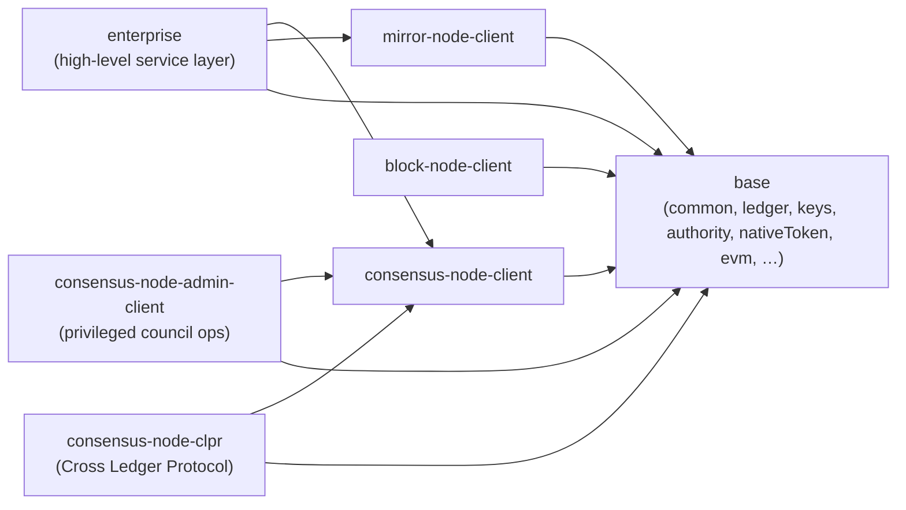
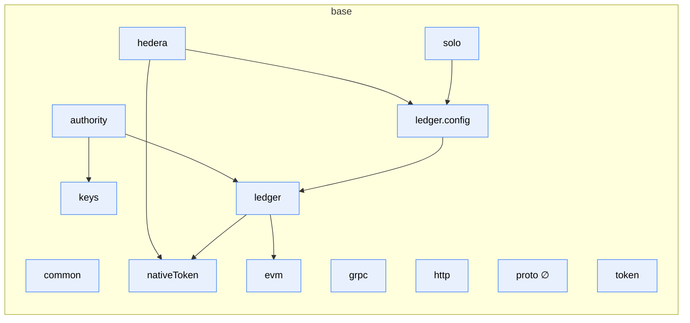
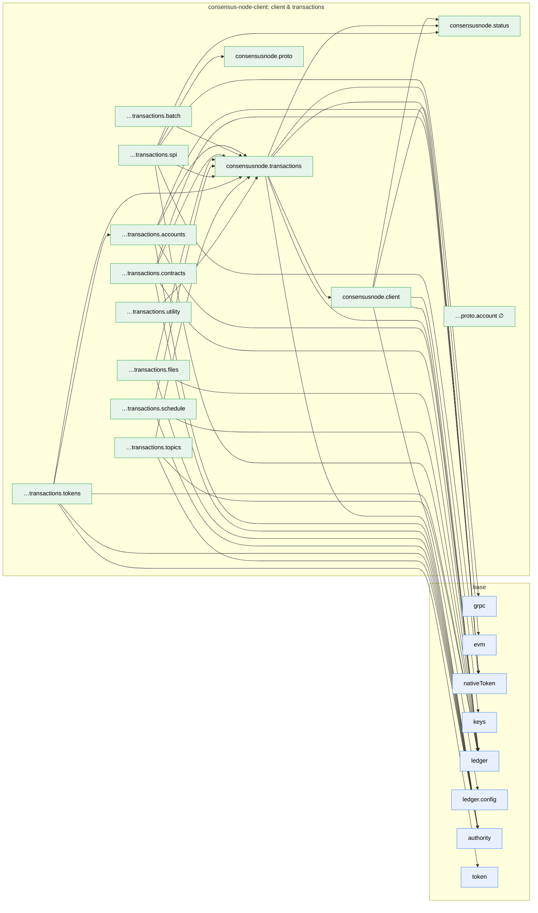
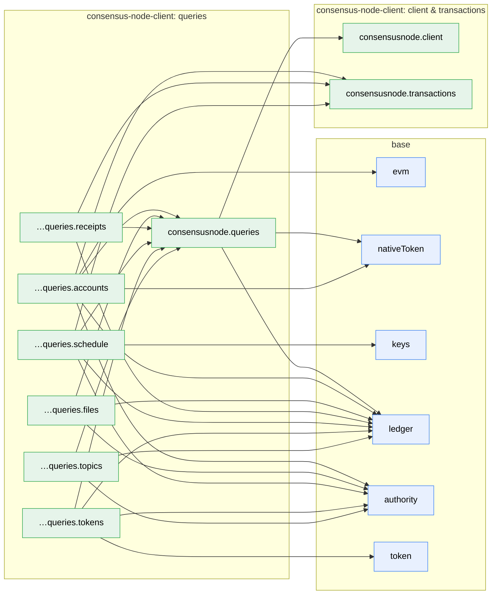
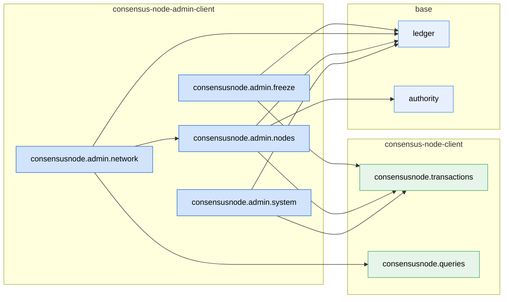
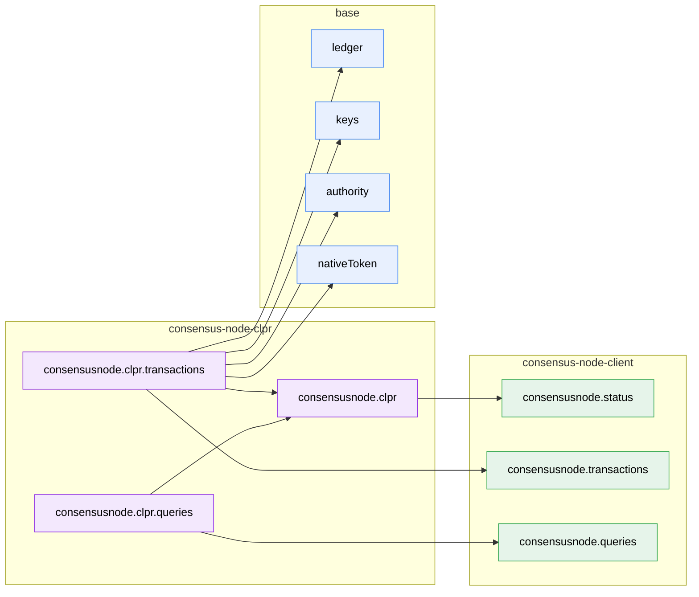
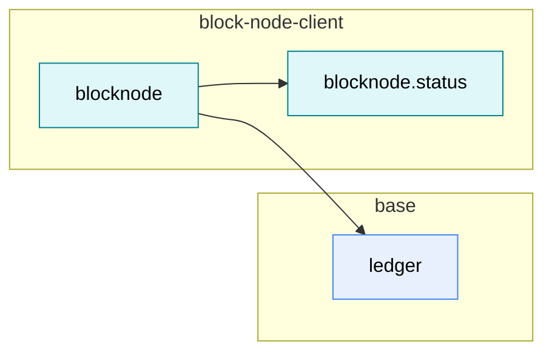
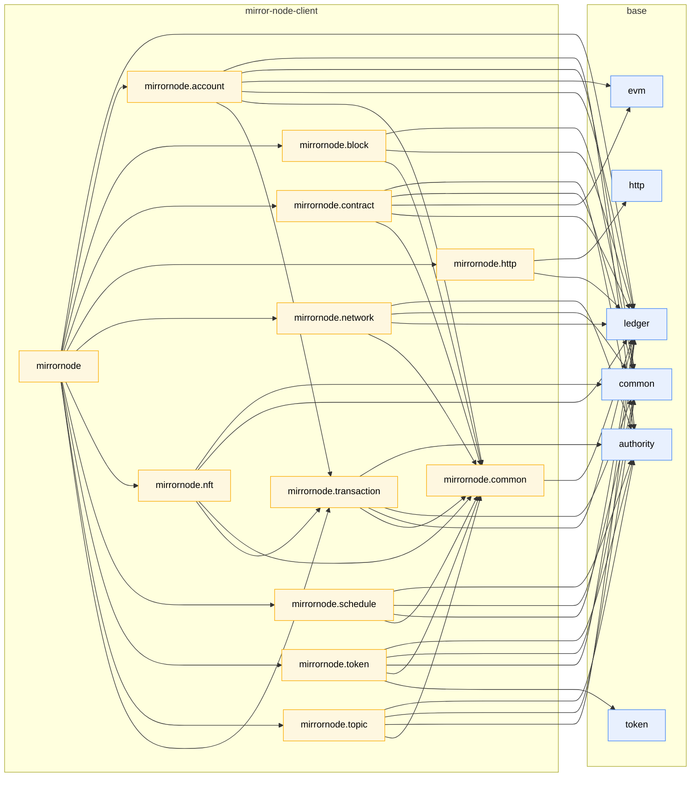
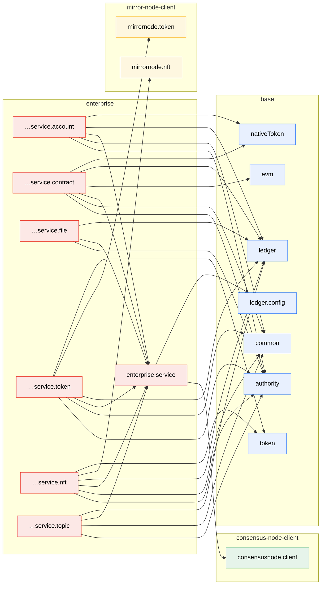

# Module / Namespace Dependencies

This document gives an overview of how the V3 API modules (namespaces) depend on each other. The graphs are derived
from the `requires {Type} from <namespace>` declarations in the spec files — an edge `A --> B` means "namespace `A`
imports one or more types from namespace `B`".

The namespaces group into the seven `spec/` folders / layers:

- **base** — `common`, `grpc`, `http`, `proto`, `evm`, `nativeToken`, `keys`, `ledger`, `ledger.config`, `authority`,
  `token`, `hedera`, `solo`
- **consensus-node-client** — `consensusnode.client`, `consensusnode.status`,
  `consensusnode.transactions[.accounts|.batch|.contracts|.files|.schedule|.spi|.tokens|.topics|.utility]`,
  `consensusnode.queries[.accounts|.files|.receipts|.schedule|.tokens|.topics]`, `consensusnode.proto[.account]`
- **consensus-node-admin-client** — `consensusnode.admin.{freeze|system|nodes|network}`
- **consensus-node-clpr** — `consensusnode.clpr[.transactions|.queries]` (Cross Ledger Protocol, HIP-1535)
- **block-node-client** — `blocknode`, `blocknode.status`
- **mirror-node-client** — `mirrornode` and its sub-namespaces (`account`, `block`, `common`, `contract`, `http`,
  `network`, `nft`, `schedule`, `token`, `topic`, `transaction`)
- **enterprise** — `enterprise.service[.account|.contract|.file|.token|.nft|.topic]`

## Layer overview

`mirror-node-client`, `block-node-client` and `consensus-node-client` are independent of each other;
`consensus-node-admin-client` is opt-in on top of `consensus-node-client` (privileged
freeze / system-delete / DAB-node transactions that normal applications do not consume);
`consensus-node-clpr` is opt-in on top of `consensus-node-client` in the same way (the CLPR service is disabled on a
ledger by default);
`enterprise` builds on top of `consensus-node-client`, `mirror-node-client`, and `base`.
Everything ultimately rests on `base`.

## Namespace dependency graphs

One graph per layer; `consensus-node-client` is split into client & transactions and queries. Each graph shows its
namespaces and every edge that starts in them; other namespaces appear only as far as they are imported, in their own
box and the color of their layer. Together the eight graphs contain every edge exactly once. `∅` marks namespaces that are still empty stubs (no types defined yet).

### base

### consensus-node-client: client & transactions

### consensus-node-client: queries

### consensus-node-admin-client

### consensus-node-clpr

### block-node-client

### mirror-node-client

### enterprise

## Observations

- **Foundation:** `ledger` (42 incoming edges) and `authority` (27) are by far the most depended-upon namespaces —
  every layer imports `ledger`, and every namespace that carries an admin/submit/supply/... key imports `Authority`.
  `keys` itself is imported only by `authority`, `consensusnode.client` (signing),
  `consensusnode.queries.schedule` and `consensusnode.clpr.transactions` (ownership proofs); everything else reaches
  keys through `Authority`. `common` (the `Page<$$T>`
  type) is required by most mirror-node namespaces and by every enterprise service that exposes paginated queries
  (`account`, `topic`, `nft`, `token`, `contract`).
- **Base-internal leaves:** `evm`, `nativeToken`, `keys`, `common`, `token`, `grpc` and `http` import nothing.
  `evm` is deliberately dependency-free (ADR-0015); `ledger` imports it for `EvmAddress`.
- **No cycles:** the dependency graph is acyclic. (The earlier `keys ↔ keys.io` cycle was removed by merging the
  `keys.io` sub-namespace into `keys`.)
- **Clean layer separation:** `mirror-node-client` has no dependency on `consensus-node-client` (or vice versa),
  `block-node-client` depends on neither, and `base` depends on nothing outside `base`. `enterprise` is the only layer that combines `consensus-node-client`,
  `mirror-node-client`, and `base` — the mirror-node edges (`…service.nft --> mirrornode.nft`,
  `…service.token --> mirrornode.token`) let the service layer reuse the domain types (`Nft`, `NftMetadata`, `Token`,
  `TokenInfo`, `Balance`) for its query methods instead of redeclaring them. (`enterprise.service.contract` keeps a
  thin local `Contract` type and therefore does not depend on `mirrornode.contract`; it imports the ABI types from
  `evm` directly.)
- **`consensusnode.transactions` is the hub of the client:** every `…transactions.*` sub-namespace, the admin
  and CLPR transactions and the queries that return receipts, records or scheduled transactions (`…queries.accounts`,
  `…queries.receipts`, `…queries.schedule`) depend on it. The only edge between two sibling sub-namespaces is
  `…transactions.tokens --> …transactions.accounts` (token airdrops reuse the transfer types).
- **Status codes:** `consensusnode.status` is imported by `consensusnode.client`, `consensusnode.transactions`,
  `…transactions.spi` and `consensusnode.clpr`, which adds the status codes of the CLPR service to the open
  `TransactionStatus`.
- **Admin layer is opt-in and one-way:** `consensus-node-admin-client` depends on `consensus-node-client` (it
  reuses `Transaction<$$Receipt, $$Self>`, `Receipt`, and the signing / packing lifecycle) but is not depended on by it —
  the edge is strictly `admin --> consensus-node-client`. Applications that never call freeze / system-delete / DAB
  node operations do not pull the admin module in. `enterprise` does not depend on the admin module either; surfacing
  these privileged operations through the high-level service layer is intentionally out of scope.
- **CLPR is opt-in and one-way as well:** `consensus-node-clpr` depends on `consensus-node-client` (transactions,
  queries, status) and on `base`, and nothing depends on it. `consensusnode.clpr` holds what its transactions and
  queries share (`ClprThrottles`, `ClprTransactionStatus`). The mirror node queries of HIP-1535 are not specified yet;
  they would go to `mirror-node-client`, not to this module.
- **The block node client is the smallest layer:** `blocknode` imports only `BlockNode` from `ledger` (declared there
  beside `ConsensusNode` and `MirrorNode`) and the status types of `blocknode.status`, which imports nothing. Blocks are
  returned as their protobuf encoding, so the layer has no dependency on the consensus node's block stream types.
- **Session as the shared root of `enterprise`:** `enterprise.service` defines the `Session` (network settings,
  operator account, transaction signer, read-your-writes high-water-mark) that every concrete service
  (`…service.account`, `…service.contract`, `…service.file`, `…service.token`, `…service.nft`, `…service.topic`)
  depends on. As a result the concrete services no longer import `ledger.config` or `consensusnode.client`
  directly — both reach them through `enterprise.service`.
- **Transport namespaces have one consumer each:** `grpc` is used only by `consensusnode.transactions.spi`, `http`
  only by `mirrornode.http`.
- **Empty stubs (no edges):** `proto` and `consensusnode.proto.account` define no types yet. `consensusnode.proto`
  (the four protobuf messages of the SPI, ADR-0009) is used only by `consensusnode.transactions.spi`.
- **Network settings are base-resident:** `hedera` (HBAR + Hedera network settings) and `solo` (the local Solo
  network) live in the base layer and depend on `ledger.config` (`hedera` also on `nativeToken`) — see the open
  question in [`native-token.md`](base/native-token.md) about whether Hedera-specific namespaces should move out of
  `base`.

> The graphs are generated from the `requires` declarations; regenerate after changing imports.
